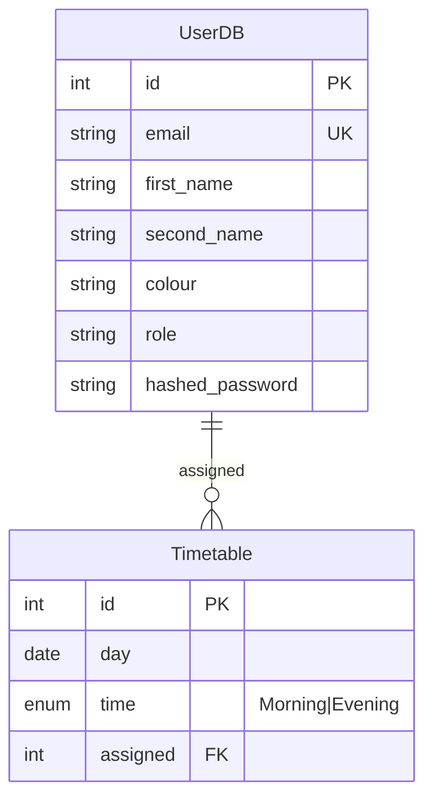

# Backend Service (BE)

FastAPI service for the chores app. Exposes the API, stores users + timetable in SQLite, issues JWTs
via `HttpOnly` cookies, and sends scheduled emails with Resend.

> Working with an AI agent? Read [`AGENTS.md`](./AGENTS.md) in this folder plus the repo root
> [`AGENTS.md`](../AGENTS.md) — they capture the conventions, test strategy and gotchas.

## Stack

Python 3.13 · FastAPI · SQLModel/SQLAlchemy 2 · SQLite · `python-jose` (JWT) · `passlib`+`bcrypt`
hashing · APScheduler · Resend · **uv** for deps · pytest + Ruff

## Layout

| Path | Purpose |
| --- | --- |
| `app/main.py` | all routes + `on_startup` lifecycle (single module by design) |
| `app/config.py` | `Settings` via pydantic-settings (cached with `lru_cache`) |
| `app/utils/database/db.py` | models (`User`, `UserDB`, `Timetable`), engine, week seeding, query helpers |
| `app/utils/auth/jwt.py` | `create_access_token`, `get_current_user`, `require_admin` |
| `app/utils/auth/password.py` | bcrypt hash/verify |
| `app/utils/notifications/resend.py` | APScheduler jobs + email HTML |
| `app/utils/stats/stats.py` | shifts-per-person since `START_DATE` (`2025-12-08`) |
| `tests/` | `conftest.py` fixtures, `test_auth.py` role matrix, `test_ready.py` startup matrix |

## Data model



- `UNIQUE(day, time)` — exactly one row per slot, two slots per day.
- `assigned = NULL` means unassigned.
- `add_weeks_dates(monday)` inserts any missing rows for that Mon–Sun week. It runs on startup in DEV
  and lazily from `GET /timetable` for the current week through +2 weeks.

## Roles

`guest` · `read-only-user` (signup default) · `user` · `admin`

Role checks hit the database (`require_admin`) rather than trusting the JWT claim. `PATCH /timetable`
requires `user` or `admin` (returns **401** for other roles).

## Endpoints

Mounted under root path `/api` in production (`root_path="/api"`); a local uvicorn run serves `/<route>`.

| Method | Path | Auth | Purpose |
| --- | --- | --- | --- |
| POST | `/token` | public | form login (`username`/`password`) → `access_token` cookie |
| POST | `/logout` | public | clears the cookie (GET/PUT/DELETE → 405) |
| POST | `/users/` | public | signup (form: `email`, `first_name`, `surename`, `colour`, `password` ≥ 8 chars) + auto-login |
| GET | `/users/` | admin | user list (`offset`, `limit` ≤ 100) |
| GET | `/users/{user_id}` | admin | one user |
| GET | `/user` | logged in | JWT claims for the caller |
| GET | `/timetable?week=YYYY-MM-DD` | none | timetable for the week of `week` (default: this week) |
| PATCH | `/timetable` | `user`\|`admin` | `{dayID, assign_to_self, week}` → assign self or clear |
| GET | `/count` | admin | shifts per person since `START_DATE` |

Cookie settings: `httponly`, `secure`, `samesite="none"`, `max_age=3600`, `path="/"` — the frontend
therefore must call over HTTPS with `credentials: "include"`.

## Environment variables

| Variable | Required | Default | Notes |
| --- | --- | --- | --- |
| `SECRET_KEY` | ✅ | — | JWT signing key |
| `RESEND_API_KEY` | ✅ | — | Resend API key |
| `ENVIRONMENT` | — | `PROD` | `DEV` seeds test data |
| `DB_PATH` | — | `data/database.db` | read in `db.py` at import time |
| `TEST_USER_EMAIL` | DEV | `""` | startup raises `KeyError` if missing in DEV |
| `TEST_USER_PASSWORD` | DEV | `""` | startup raises `KeyError` if missing in DEV |
| `DISABLE_GUEST_MODE` | — | `false` | `true` skips guest user creation |

Copy [`.env.example`](./.env.example) to `.env` and fill it in.

## Startup order (`on_startup`)

1. Settings validation (DEV requires test user credentials — raises `KeyError` otherwise).
2. `create_db_and_tables()`.
3. `start_notifications_scheduler()` — daily 09:00 summary, Sunday 21:00 reminder (in-process).
4. `create_guest_user()` unless `DISABLE_GUEST_MODE`.
5. DEV only: `add_weeks_dates()` + `create_test_user()` (role `admin`).

## Setup & run

```bash
cd BE
cp .env.example .env            # fill in SECRET_KEY / RESEND_API_KEY
uv sync                         # installs from uv.lock into .venv
make run                        # uvicorn --reload with local TLS on :8000
```

`local_cert/` is gitignored; regenerate the self-signed certs (mkcert is easiest) if `make run` fails
to find them. Windows users: `make win`.

## Tests

```bash
uv run pytest -v       # or `make test`
uv run ruff check . && uv run ruff format .
```

`conftest.py` overrides `get_session` with an in-memory SQLite (`StaticPool`, one seeded week) and
`get_settings_dep` with a fake `Settings`. Tests never touch `data/database.db`, the network, or Resend.

## Notes / gotchas

- **No migrations.** `SQLModel.metadata.create_all` only creates tables — delete `data/database.db`
  after a model change locally.
- CI runs Python 3.11 while `pyproject.toml` requires ≥ 3.13; investigate that before blaming the code.
- `bcrypt==4.0.1` is pinned because passlib 1.7.4 breaks on newer bcrypt.
- The scheduler lives in the API process: multiple workers/replicas ⇒ duplicate emails.
- `uv install` is not a command — use `uv sync`.
