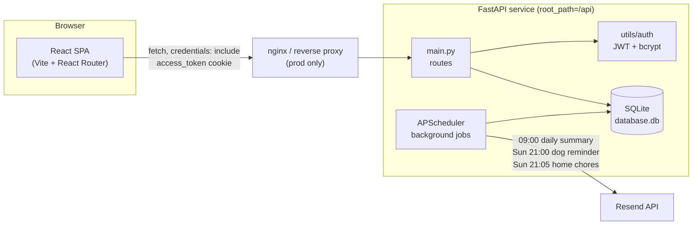
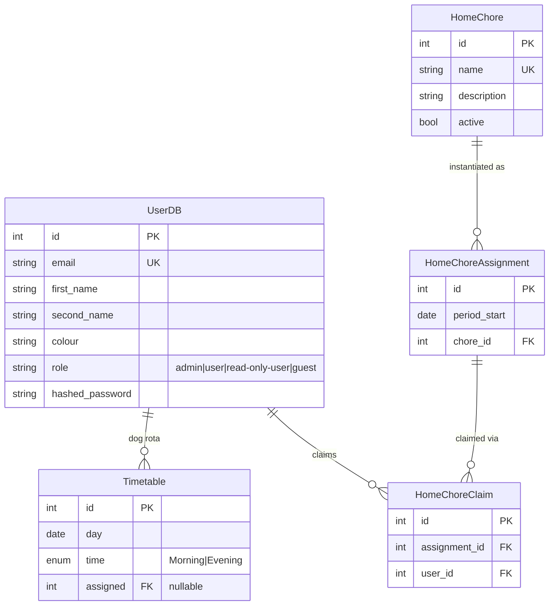

# Chores App 🐾


A small household **chores app** with two sections. Users sign up and get:

- **Dog chores** — a weekly rota (Monday → Sunday, Morning + Evening slots) they assign themselves to.
  The backend emails a daily summary of who is walking today and a Sunday-night reminder to fill in
  the coming week.
- **Home chores** — a fortnightly list (e.g. cleaning the house, grocery shopping) where each chore can
  be claimed by one person or shared. A reminder is emailed on the Sunday before each new fortnight.

---

## Table of contents

- [Quickstart](#quickstart)
- [Repository map](#repository-map)
- [Architecture](#architecture)
- [Domain model](#domain-model)
- [API reference](#api-reference)
- [Roles & permissions](#roles--permissions)
- [Environment variables](#environment-variables)
- [Common workflows](#common-workflows)
- [Testing & CI](#testing--ci)
- [Deployment](#deployment)
- [Conventions](#conventions)
- [Known gaps](#known-gaps)
- [Docs index](#docs-index)

---

## Quickstart

Two processes: the FastAPI backend on `:8000`, the Vite frontend on `:5173`. Both are expected to run
over **HTTPS** locally (`https://local.app.com`, certs in each package's `local_cert/` folder) because
the auth cookie is `secure; samesite=none`.

```bash
# 1. Backend
cd BE
cp .env.example .env          # then fill in SECRET_KEY / RESEND_API_KEY
uv sync
make run                      # uvicorn + local TLS on https://0.0.0.0:8000

# 2. Frontend (second terminal)
cd FE/chores
cp .env.example .env.development
npm ci
npm run dev                   # vite on https://local.app.com:5173
```

You will need `local.app.com` pointing at `127.0.0.1` in `/etc/hosts`:

```
127.0.0.1 local.app.com
```

In `DEV` mode the backend seeds a test user (`TEST_USER_EMAIL` / `TEST_USER_PASSWORD`) and 3 weeks of
timetable rows. **Guest Mode** logs in as `guest@example.com` / `guestpassword` (read-only).

## Repository map

```
chores/
├── AGENTS.md                      # how AI agents (and new humans) should work in this repo
├── README.md                      # you are here
├── docker-compose.yml             # backend container + SQLite volume mount
├── .github/workflows/tests.yml    # CI: pytest on push/PR
│
├── BE/                            # Python 3.13 FastAPI service
│   ├── AGENTS.md                  # backend-specific conventions
│   ├── README.md                  # backend reference
│   ├── Makefile                   # `make run` (TLS, reload) / `make test`
│   ├── Dockerfile                 # uv-based image, serves uvicorn on :8000
│   ├── pyproject.toml, uv.lock     # deps + lockfile (uv, not pip)
│   ├── .env.example               # document of required vars
│   ├── app/
│   │   ├── main.py                # ALL routes + startup lifecycle (single file)
│   │   ├── config.py              # pydantic-settings Settings
│   │   └── utils/
│   │       ├── auth/jwt.py        # token creation, get_current_user, require_admin
│   │       ├── auth/password.py   # bcrypt hashing via passlib
│   │       ├── database/db.py     # SQLModel models, engine, week/fortnight seeding + queries
│   │       ├── notifications/resend.py  # APScheduler jobs → Resend emails
│   │       └── stats/stats.py     # per-person shift counts since START_DATE
│   ├── data/database.db           # local SQLite (gitignored)
│   ├── local_cert/                # self-signed TLS (gitignored)
│   └── tests/                     # conftest fixtures + auth/startup tests
│
└── FE/chores/                     # React 19 + Vite + TS + Tailwind 4
    ├── AGENTS.md                  # frontend-specific conventions
    ├── README.md                  # frontend reference
    ├── .env.example               # template for the two files below
    ├── .env.development           # VITE_API_BASE for local dev
    ├── .env.production            # VITE_API_BASE for prod
    ├── Dockerfile, nginx.conf     # static build served by nginx (SPA fallback)
    └── src/
        ├── main.tsx               # providers + route table
        ├── pages/                 # DogChores (rota), HomeChores, Login, SignUp, Settings, Stats
        ├── components/            # Navbar/NavMenu, MergedDayCell, EditPanel, Summary, guards
        ├── components/ui/         # shadcn/ui primitives (button, card, input)
        ├── context/               # UserContext (auth), EditContext (edit panel)
        ├── utils/                 # fetch.ts (API URL), timetable.ts (types + date math)
        └── types/user.ts          # shared User / TokenData shapes
```

## Architecture



- **Auth is cookie-based.** `POST /token` sets an `HttpOnly`, `Secure`, `SameSite=None` `access_token`
  cookie (HS256 JWT, 30 min expiry). The frontend never sees the token; it just sends
  `credentials: "include"` and asks `GET /user` who it is.
- **Root path.** `app = FastAPI(root_path="/api")`, so production URLs are `/api/<route>`, while a
  locally-run uvicorn serves plain `/<route>` on port 8000 (the dev `.env` accounts for this).
- **Scheduling lives in the API process.** Emails fire from APScheduler inside the uvicorn worker —
  fine for a single container, dangerous if you ever scale to multiple workers/replicas.

## Domain model



### Dog rota (weekly)

- One `Timetable` row per **(day, time)** pair — enforced by `UniqueConstraint("day", "time")`. Two
  rows per day, 14 per week.
- `assigned` is nullable: `NULL` means *unassigned*, and a slot has at most one walker.
- **Weeks are seeded lazily.** `add_weeks_dates(week)` inserts any missing rows for that Monday → Sunday.
  It runs at startup (DEV only) and again inside `GET /chores/dog-walking` for the current week
  through +2 weeks ahead.
- A "week" is always identified by its **Monday** (`get_last_monday()`).

### Home chores (fortnightly)

- `HomeChore` is the catalogue (name + description). `active` is a soft delete, so retiring a chore
  never breaks its history.
- `HomeChoreAssignment` is one chore **in one fortnight**, `UNIQUE(period_start, chore_id)`.
- `HomeChoreClaim` is zero or more owners per assignment, `UNIQUE(assignment_id, user_id)`. Several
  people can share a chore, so joining an already-claimed chore is normal.
- A "period" is 14 days anchored to a Monday, `FORTNIGHT_ANCHOR = 2025-12-08` (== `START_DATE`).
  **This constant is a contract:** changing it re-keys every period and orphans existing claims.
- Seeding: the catalogue and the current fortnight are created on startup in **every** environment;
  reads lazily seed the current and next fortnight only. Past periods return empty rather than
  inventing assignments.

## API reference

All routes are mounted under the root path `/api`.

| Method | Path | Auth | Purpose |
| --- | --- | --- | --- |
| `POST` | `/token` | public | OAuth2 password form login → sets `access_token` cookie |
| `POST` | `/logout` | public | Deletes the auth cookie (POST only; GET → 405) |
| `POST` | `/users/` | public | Sign up; creates user (`read-only-user` role) + logs them in |
| `GET` | `/users/` | admin | Paginated user list (`offset`, `limit` ≤ 100) |
| `GET` | `/users/{user_id}` | admin | Single user |
| `GET` | `/user` | any logged-in | Current user claims from the JWT |
| `GET` | `/chores/dog-walking?week=YYYY-MM-DD` | none | Dog rota for the week containing/beginning at `week` (defaults to this week) |
| `PATCH` | `/chores/dog-walking` | `admin` \| `user` | Assign/unassign the caller to one slot |
| `GET` | `/chores/home?period=YYYY-MM-DD` | none | Home chores for the fortnight containing `period` (defaults to the current one) |
| `PATCH` | `/chores/home` | `admin` \| `user` | Claim/leave one home chore for the caller |
| `GET` | `/count` | admin | Dog shifts per person since `START_DATE` (`2025-12-08`) |

`PATCH /chores/dog-walking` body:

```json
{ "dayID": 42, "assign_to_self": true, "week": "2025-12-08" }
```

- `assign_to_self: true` → assign the row to the calling user; omitted/`false` → clear the assignment.
- `week` is echoed back so the response is the refreshed timetable for that week.
- There is no admin "assign to *someone else*" path yet — see [Known gaps](#known-gaps).

`PATCH /chores/home` body:

```json
{ "assignmentID": 7, "claimed": true, "period": "2026-01-05" }
```

- `claimed` is **explicit**, not a toggle: retries are safe and two people clicking at once cannot
  clobber each other. Leaving only ever removes the caller's own claim.
- `period` is normalised to the fortnight's Monday, and the response is the refreshed period.
- `GET` is public but personalises `claimed_by_me` when a session cookie is present.

## Roles & permissions

| Role | Dog rota view | Assign self | Home chores view | Claim home chore | Stats page | User admin endpoints |
| --- | --- | --- | --- | --- | --- | --- |
| `guest` | ✅ | ❌ | ✅ | ❌ | ❌ | ❌ |
| `read-only-user` (default on signup) | ✅ | ❌ | ✅ | ❌ | ❌ | ❌ |
| `user` | ✅ | ✅ | ✅ | ✅ | ❌ | ❌ |
| `admin` | ✅ | ✅ | ✅ | ✅ | ✅ | ✅ |

The frontend guards routes with `ProtectedRoute` (any user) and `ProtectedAdminRoute` (admin only);
the UI hides the edit affordances for `guest`/`read-only-user`. **Backend checks are authoritative** —
`require_admin()` re-reads the role from the DB, and both `PATCH` endpoints reject non-`user`/`admin`
roles with **401**.

## Environment variables

### Backend (`BE/.env`)

| Variable | Required | Default | Notes |
| --- | --- | --- | --- |
| `SECRET_KEY` | ✅ | — | JWT signing key |
| `RESEND_API_KEY` | ✅ | — | Resend email API key |
| `ENVIRONMENT` | — | `PROD` | Set to `DEV` to seed test data |
| `DB_PATH` | — | `data/database.db` | SQLite file path (`/app/data/database.db` in Docker) |
| `TEST_USER_EMAIL` | DEV only | `""` | Startup fails in DEV if missing |
| `TEST_USER_PASSWORD` | DEV only | `""` | Startup fails in DEV if missing |
| `DISABLE_GUEST_MODE` | — | `false` | `true` skips guest-user creation |

### Frontend (`FE/chores/.env.*`)

| Variable | Required | Notes |
| --- | --- | --- |
| `VITE_API_BASE` | ✅ | API prefix, e.g. `https://local.app.com:8000` (dev) or `https://chores.dempseypalaciotascon.com/api` (prod) |
| `VITE_DISABLE_GUEST` | — | `"true"` hides the Guest Mode button on `/login` |

## Common workflows

### Add an API endpoint
1. Write the route in `BE/app/main.py` (this repo keeps all routes in one module).
2. Reuse `SessionDep`, `TokenData = Depends(get_current_user)` or `UserDB = Depends(require_admin)`.
3. Add/extend tests in `BE/tests/test_auth.py` (permission matrix) or a new `test_*.py`.
4. Update the [API reference](#api-reference) table and `BE/README.md`.

### Add a page
1. Create `FE/chores/src/pages/<Name>.tsx`.
2. Register it in `FE/chores/src/main.tsx` inside `ProtectedRoute` (or `ProtectedAdminRoute`).
3. Call the API with `fetchURL("/...")` from `@/utils/fetch` and `credentials: "include"`.
4. Add a nav link in `components/Navbar.tsx` (admin-only links are gated on `user.role`).

### Change the database schema
1. Edit the models in `BE/app/utils/database/db.py`.
2. `create_db_and_tables()` uses `SQLModel.metadata.create_all` — it creates tables, it does **not**
   migrate existing ones. Delete `BE/data/database.db` (or write a manual `ALTER TABLE`) locally.
3. Update `docs`/READMEs; there is no migration tool in the repo yet.

## Testing & CI

```bash
cd BE && uv run pytest -v     # 58 passed — also `make test`
cd FE/chores && npm run build # tsc -b + vite build — passes
cd FE/chores && npm run lint  # passes
```

- `BE/tests/conftest.py` swaps the app's DB dependency for an **in-memory SQLite** session and a fake
  `Settings` (`secret_key="test-secret"`), so tests never touch `data/database.db` or real email.
- `test_auth.py` is a parametrised permission matrix over all four roles.
- `test_home_chores.py` covers fortnight maths (including pre-anchor dates), idempotent seeding,
  claim/unclaim, shared chores and the role matrix.
- `test_notifications.py` covers the fortnightly email's date decision; the calendar logic lives in
  pure functions so it needs no clock freezing.
- `test_ready.py` mocks the startup hooks to verify DEV/PROD + guest-mode combinations.
- **The frontend has no test suite** — `npm run build` (tsc + vite) is the real gate, and `npm run
  lint` is clean. Both must stay green.
- CI (`.github/workflows/tests.yml`) runs `uv sync && uv run pytest tests -v` on push to `main` and on
  PRs. ⚠️ It pins Python **3.11** while `pyproject.toml` requires `>=3.13` — see [Known gaps](#known-gaps).

## Deployment

**Backend** — `docker compose up --build` builds `BE/Dockerfile` (uv sync inside the image), exposes
`:8000`, and mounts `./BE/data` → `/app/data` so SQLite survives restarts. Image: `deejtsn/private:chores_api_v1`.

**Frontend** — `FE/chores/Dockerfile` is a two-stage build (`npm run build` → nginx) with an
`nginx.conf` that falls back to `index.html` for React Router paths. `VITE_API_BASE` is baked in at
build time, so rebuild the image when the API URL changes.

**Environment.** The `api` service reads `BE/.env` via `env_file:`. `SECRET_KEY` and `RESEND_API_KEY`
have no defaults in `app/config.py`, so if that file is missing or incomplete the container dies during
startup with `pydantic_core._pydantic_core.ValidationError: 2 validation errors for Settings` and
exit code 3 (Compose's `restart: always` then turns it into a crash loop). Start from
`BE/.env.example`, and set `ENVIRONMENT=PROD` in production.

### Pre-deploy checklist

Run in this order; each step assumes the previous one passed.

1. **Green checks.** `cd BE && uv run pytest -v` (58 passed) · `cd FE/chores && npm run build && npm run lint`.
   `uv run ruff check .` should stay at the 6-finding baseline — no new ones.
2. **Merge via PR.** `.github/workflows/tests.yml` only runs on `pull_request` and `push: [main]`, so an
   unmerged branch has **never been CI'd**. Check the PR is green before merging.
3. **Host env.** `BE/.env` exists on the server with `SECRET_KEY`, `RESEND_API_KEY`, `ENVIRONMENT=PROD`.
4. **Back up the volume.** `cp BE/data/database.db` somewhere safe. No migrations exist, but the 3
   home-chore tables are purely additive (`create_all` makes them), so the restore path is "put the old
   file back", never "delete the DB".
5. **Deploy backend and frontend together.** The dog rota moved from `/timetable` to
   `/chores/dog-walking` with **no alias**, so either order alone breaks the rota page until the other
   half ships. Keep the window short or reintroduce a temporary alias on the old paths.
6. **Smoke test unauthenticated:** `GET /api/chores/home` and `GET /api/chores/dog-walking` both return
   JSON (200, not 404/500), then log in at `/login` and confirm a claim toggle round-trips.
7. **Check the email jobs.** The daily 09:00 dog email is unchanged; the new Sunday 21:00 home-chores
   job runs every Sunday but only sends when the coming Monday is a fortnight anchor. Verify
   `get_email_list()` recipients before leaving it unattended — it sends real mail via Resend.

## Conventions

- **Backend:** Python 3.13, `uv` for deps, Ruff for lint/format, SQLModel for models, endpoints return
  Pydantic models rather than raw dicts, snake_case in Python / camelCase only in wire formats that
  already use it (`weekStart`).
- **Frontend:** TypeScript in strict mode, `@/` alias for `src/`, function components + hooks, context
  providers instead of a state library, Tailwind utilities inline, shadcn/ui primitives in `components/ui`.
- **Commits:** imperative, short scope prefixes are fine (`add logout feature`, `refactor get_timetable`).
- Clickable/AI-readable specifics live in [`AGENTS.md`](./AGENTS.md), [`BE/AGENTS.md`](./BE/AGENTS.md)
  and [`FE/chores/AGENTS.md`](./FE/chores/AGENTS.md).

## Known gaps

Documented so nobody has to rediscover them:

- **No migrations.** Schema changes require deleting the SQLite file (or a hand-written
  `ALTER TABLE`). The home-chores work was deliberately additive so it needed neither — see
  [`plan/home-chores.md`](./plan/home-chores.md).
- **Backend Ruff baseline.** `cd BE && uv run ruff check .` reports 6 pre-existing `F401`/`F841`
  findings (`User` and `Date` imports, `email = resend.Emails.send(...)` in two senders, two unused
  test imports). Introduce no new ones; fixing the baseline is its own change.
- **Home chores share one cadence.** Everything is fortnightly; a mixed weekly/fortnightly list needs
  a `cadence` column and two seeding branches.
- **The chore catalogue is code-seeded.** Adding a chore means editing `DEFAULT_HOME_CHORES` and
  redeploying; admin CRUD was deliberately deferred.
- **`FORTNIGHT_ANCHOR` is a constant, not config.** Changing it re-keys every period — treat it like
  the API contract it is.
- **`@app.on_event("startup")` is deprecated** in FastAPI; the lifespan-context migration is pending
  (tests patch `on_startup` by name, so migrate both together).
- **CI Python version mismatch** (3.11 in workflow vs `>=3.13` in `pyproject.toml`).
- **`Settings` uses `Field(..., env=...)`** which pydantic-settings v2 largely ignores; env names are
  matched case-insensitively by field name, so this works by luck rather than design.
- **Admins cannot assign a slot to another person** — both `PATCH` endpoints only support *self*.
- **Guest credentials are hardcoded** in `FE/chores/src/pages/Login.tsx` and in
  `create_guest_user()`; changing one requires changing the other.
- **Scheduler is in-process** — multiple uvicorn workers would duplicate emails.
- **Unused scaffolding:** `components/Snackbar.tsx`, `context/SnackbarContext.ts` (it declares a
  second `EditPanelProvider` that is never mounted), and `pages/Settings.tsx` (stub returning text).
- **`test_ready.py` patches `app.main.get_settings`** while `on_startup` also resolves settings through
  the cached `get_settings()` — refactor with care, the mocks are coupled to those names.
- No license file and no contributing guide.

## Docs index

| File | What it covers |
| --- | --- |
| [`AGENTS.md`](./AGENTS.md) | Repo-wide instructions for AI agents and contributors |
| [`BE/README.md`](./BE/README.md) | Backend reference: modules, endpoints, env, running |
| [`BE/AGENTS.md`](./BE/AGENTS.md) | Backend rules: uv, SQLModel, testing, patterns to follow |
| [`FE/chores/README.md`](./FE/chores/README.md) | Frontend reference: structure, routes, env |
| [`FE/chores/AGENTS.md`](./FE/chores/AGENTS.md) | Frontend rules: TS strictness, aliases, styling, data flow |
| [`plan/home-chores.md`](./plan/home-chores.md) | Plan and rationale for the two-section chores app |
