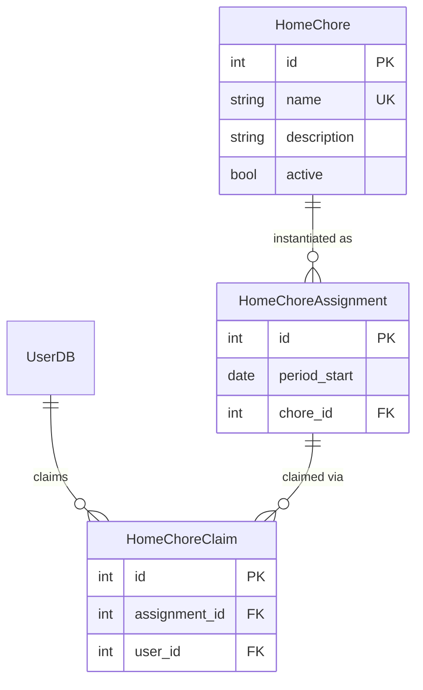

# Plan: dog chores → subsection of a multi-chore app (+ fortnightly home chores)

**Status:** implemented on this branch (§13 lists the commits); §12 records the choices made
**Branch:** `plan/home-chores`
**Date:** 2026-04
**Scope:** `BE/`, `FE/chores/`, docs

---

## 1. Background

Today the app *is* the dog-walking rota. `Timetable` is `(day, time ∈ {Morning, Evening}, assigned)` with
`UNIQUE(day, time)`, seeded 7 days at a time by `add_weeks_dates()`, and it is the sole data source for
the timetable page, the daily 09:00 email, and `/count`.

The goal is to make the dog rota **one subsection of a chores app**, with a second subsection for
**fortnightly home chores** (cleaning the house, grocery shopping, and later more).

This is deliberately *not* a schema generalisation. See §11 for the (deferred) generic design.

## 2. Constraints that drive the design

| Fact | Consequence |
| --- | --- |
| `Timetable` holds real history since `2025-12-08`, consumed by `GET /count` | Do not rename or reshape it. Add new tables beside it. |
| `create_db_and_tables()` runs `SQLModel.metadata.create_all` on every startup | New tables appear automatically → **this design needs no DB deletion and loses no data**. |
| Repo has **no migration tool** | Any change to an *existing* column means a manual `ALTER TABLE` on the deployed volume. Strongly avoid. |
| `GET /timetable` is currently public (no auth dependency) | Home-chore reads stay public too, for symmetry. |
| Week/date maths lives in `BE/app/utils/database/db.py` | Fortnight maths goes there as well. Never inline period computation in a handler. |
| FE + BE deploy together; the SPA is the only API consumer | API route renames are safe in a single PR; `BE/tests/` is the only other consumer. |
| `add_weeks_dates()` opens its **own** `Session(engine)` | Latent test-safety trap — see §10.1. Do not copy the pattern. |

## 3. Locked decisions

Confirmed with the product owner:

| # | Decision |
| --- | --- |
| 1 | **Fortnightly.** One period = 14 days, anchored to a Monday. `FORTNIGHT_ANCHOR = 2025-12-08` (already `START_DATE`, already a Monday). |
| 2 | **Uniform cadence.** Cleaning and shopping are *both* every 2 weeks. No `cadence` column. |
| 3 | Chores are **separate instances with per-instance owners**; group ownership ("me and person X") must be supported. |
| 4 | **Self-claim only.** No admin "assign to someone else" endpoint. Role gate identical to dogs: `user`/`admin`, **401** for other roles. |
| 5 | The chore list is a **table**, not an enum — adding "chore Y" is a data insert, never a model change. |
| 6 | **No completion tracking.** Assignment alone. `/count` stays dog-only. |

## 4. Target information architecture

```
/login, /sign-up                       public
/stats                                 admin
/chores/dog-walking                    weekly rota (today's Home page)
/chores/home                           fortnightly home chores (new)
/home                                  → redirect to /chores/dog-walking
```

Navbar: **Dog chores · Home chores · Stats** (admin only).

> ⚠️ `components/NavLink.tsx` marks active with `location.pathname.startsWith(path)`. A `/home` link
> would light up on `/home-chores`. Nested `/chores/...` paths avoid the collision, but fix the matcher
> to `pathname === path || pathname.startsWith(path + "/")` regardless.

## 5. Data model

Three additive tables. `UserDB` and `Timetable` are untouched.



- `HomeChore` — the catalogue. `active` is a soft-delete flag so removing a chore never breaks history.
- `HomeChoreAssignment` — the *instance* of a chore in one fortnight. `UNIQUE(period_start, chore_id)`.
- `HomeChoreClaim` — **zero or more** owners of an instance. `UNIQUE(assignment_id, user_id)` makes a
  claim idempotent and allows the group case ("me and person X") with no extra feature work.

### 5.1 Why a claims join table instead of a single `assigned` FK

The dog `Timetable` uses one nullable FK because exactly one person walks a dog at a time. Home chores
can be joint, and this repo **cannot migrate schemas**. A single-owner column would make the group case
a future table addition + manual data migration + rewrite of `PATCH` and the card UI.

Cost of doing it right now: one extra table, one join, a list instead of a string in the response, and
a toggle instead of a set/clear. Roughly 20 lines.

**Alternative if the group case is definitively dropped:** single nullable
`HomeChoreAssignment.assigned → userdb.id`, mirroring `Timetable`. Simpler by ~20 lines, but locks out
group owners permanently without a migration. Not recommended.

### 5.2 Response models

Mirrors the existing dog models, including the intentional camelCase wire asymmetry (`weekStart` →
`periodStart`):

```python
class HomeChorePublic(BaseModel):
    id: int                          # assignment id — PATCH targets this
    chore: str
    description: str
    claimed_by: list[str]            # first names, display only
    claimed_by_me: bool              # computed server-side; names are not unique keys

class HomeChorePeriodData(BaseModel):
    periodStart: datetime.date
    chores: list[HomeChorePublic]
```

`claimed_by_me` is computed from the caller's identity when authenticated and `false` for anonymous
callers. The FE must not infer "mine" by string-comparing first names.

## 6. Fortnight maths

Lives in `BE/app/utils/database/db.py`, next to `get_last_monday` / `week_dependency`.

```python
FORTNIGHT_ANCHOR = datetime.date(2025, 12, 8)      # Monday; same as START_DATE

def get_fortnight_start(d: datetime.date | None = None) -> datetime.date:
    d = d or datetime.date.today()
    return FORTNIGHT_ANCHOR + datetime.timedelta(days=((d - FORTNIGHT_ANCHOR).days // 14) * 14)

def fortnight_dependency(period: datetime.date | None = None) -> datetime.date:
    return get_fortnight_start(period)
```

Three traps:

1. **Never use `week_dependency` for home chores.** Snapping to Monday first would make *every week* a
   new period, silently doubling the rota.
2. Python floor division handles pre-anchor dates correctly (`-1 // 14 == -1` → `anchor - 14`). Cover it
   with a test rather than trusting it.
3. **The anchor is a permanent contract.** Changing it later re-keys every period and orphans claims.
   Keep it a module constant, not an env var, and say so in a comment.

## 7. API contract

All routes mounted under the existing `root_path="/api"`.

| Method | Path | Auth | Replaces |
| --- | --- | --- | --- |
| `GET` | `/chores/dog-walking?week=YYYY-MM-DD` | none | `GET /timetable` |
| `PATCH` | `/chores/dog-walking` | `user`\|`admin` | `PATCH /timetable` |
| `GET` | `/chores/home?period=YYYY-MM-DD` | none | — (new) |
| `PATCH` | `/chores/home` | `user`\|`admin` | — (new) |

```json
// GET /chores/home?period=2026-01-05
{
  "periodStart": "2026-01-05",
  "chores": [
    { "id": 12, "chore": "Clean the house", "description": "…",
      "claimed_by": ["Alice", "Bob"], "claimed_by_me": false },
    { "id": 13, "chore": "Grocery shopping", "description": "…",
      "claimed_by": [], "claimed_by_me": false }
  ]
}
```

```json
// PATCH /chores/home
{ "assignmentID": 13, "claimed": true, "period": "2026-01-05" }
```

- `claimed` is **explicit**, not a toggle-by-omission. Two people clicking concurrently cannot clobber
  each other, and retries are safe. (Contrast the dog endpoint's `assign_to_self: bool | None`.)
- Repeat with `claimed: false` to leave. Leaving only ever removes *your own* claim.
- Response is the refreshed period, so the FE replaces client state without refetching — same contract
  as `PATCH /timetable`.
- Unknown `assignmentID` → 404. Role not in `{user, admin}` → **401** (keep the existing convention the
  tests assert; do not "fix" it to 403 here without updating the matrix intentionally).

## 8. Seeding

```python
DEFAULT_HOME_CHORES = ("Clean the house", "Grocery shopping")   # idempotent by name

def create_home_chores() -> None:                        # catalogue; every environment; startup
def add_period_assignments(session, period_start) -> None:  # cross-product of *active* chores
```

Startup order in `on_startup()` becomes:

1. settings validation (DEV requires test-user credentials)
2. `create_db_and_tables()`
3. `start_notifications_scheduler(settings)`
4. `create_guest_user()` unless `DISABLE_GUEST_MODE`
5. **`create_home_chores()`**
6. **`add_period_assignments(current fortnight)`**
7. DEV only: `add_weeks_dates()` + `create_test_user()`

Notes:

- Seeding the current fortnight in **all** environments matters — unlike dogs (DEV-startup only, then
  lazy), production would otherwise render an empty page on first deploy.
- Lazy-seed **current → +1 fortnight** from `GET`, mirroring the dog rota's current → +2 weeks.
- Do **not** backfill past periods. An old fortnight returns an empty list rather than inventing claims.
- Because `add_period_assignments` is keyed on `(period_start, chore_id)`, a chore added to the
  catalogue next month automatically appears for any period that is fetched afterwards.

### 8.1 Session handling — important

`add_period_assignments` **must accept the request `Session`**, not open its own. `add_weeks_dates()`
currently calls `Session(engine)` directly, i.e. the real `data/database.db`, bypassing the
`get_session` dependency override. It only avoids corrupting tests today because `conftest.py` pre-seeds
a week so the lazy branch never fires.

If the new seeding copies that pattern, `tests/test_home_chores.py` will write to the developer's
database. Separate ticket (or a small drive-by): give `add_weeks_dates` the same treatment, or at
minimum document why it is the accepted exception.

## 9. Email

`BE/app/utils/notifications/resend.py`:

- Rename `send_daily_email` → `send_daily_dog_walkers_email` (nothing patches it; `test_ready.py` only
  patches `start_notifications_scheduler`).
- Add `send_home_chores_email()` rendering the upcoming fortnight's chores and claimants.
- New job: **Sunday 21:00 weekly, no-op unless the coming Monday is a fortnight anchor**
  (`get_fortnight_start(next_monday) == next_monday`). Expressing "every other week" as a guarded weekly
  cron is simpler and more inspectable than APScheduler interval alignment.
- The daily 09:00 dog email is unchanged. `get_dog_walkers_for_today()` keeps its name.
- Scheduler still lives in the API process; multiple workers ⇒ duplicate emails (pre-existing).

## 10. Backend tests

New `BE/tests/test_home_chores.py`:

- fortnight maths: anchor, anchor+7 (same period), anchor+13 (same period), anchor+14 (next period),
  pre-anchor date (previous period)
- off-week `?period=` normalises to the same `periodStart`
- `UNIQUE(period_start, chore_id)` and `UNIQUE(assignment_id, user_id)` enforced
- claim add is idempotent; claim remove is idempotent
- two users claiming the same chore → both names in `claimed_by`
- `claimed_by_me` true only for the caller
- leaving one's claim never removes someone else's
- 401 for `guest` and `read-only-user` on `PATCH`
- `GET` works unauthenticated
- seeding is idempotent; a newly added catalogue chore backfills an existing period

Updates to existing tests:

- `test_auth.py` — add `/chores/home` PATCH to the parametrised role matrix and to the
  unauthenticated-endpoint list; update renamed dog paths (`GET`/`PATCH /chores/dog-walking`).
- `conftest.py` — seed the catalogue and the current period's assignments.
- `test_ready.py` — **will fail** once `on_startup` gains calls. Add
  `@patch('app.main.create_home_chores')` and `@patch('app.main.add_period_assignments')` and assert the
  ordering. This file patches `app.main.*` by name; renames must be mirrored there or the tests silently
  stop asserting anything.

### 10.1 Landmine: private engine in seeding

See §8.1. Practically: any test that exercises the lazy-seed branch must prove it did not touch
`data/database.db`. Passing the request session is the fix.

## 11. Frontend

| File | Change |
| --- | --- |
| `src/pages/HomeChores.tsx` | **new** — fortnight nav (±1 period via `ONE_WEEK_MS * 2`, never `setDate()`), chore cards, "chores to claim" counter, summary popover |
| `src/components/HomeChoreCard.tsx` | **new** — name, description, claimant chips, join/leave affordance, role-gated |
| `src/pages/Home.tsx` → `src/pages/DogChores.tsx` | rename; point at `/chores/dog-walking`; logic unchanged |
| `src/utils/homeChores.ts` | **new** — API types, `getFortnightStart`, `addFortnights`, period label formatter |
| `src/components/Summary.tsx` | accept `counts: Record<string, number>`; each page computes its own |
| `src/components/Navbar.tsx` | two section links + admin Stats |
| `src/components/NavLink.tsx` | fix active matching (`startsWith` collision) |
| `src/main.tsx` | register `/chores/dog-walking`, `/chores/home`, `/home` → redirect |
| `src/utils/timetable.ts` | **unchanged** — dog-specific; renaming is churn, not clarity |
| `src/components/EditPanel.tsx`, `context/EditContext.ts` | **unchanged if inline claiming is chosen** (see §12.2) |

Notes:

- Do **not** reuse `MergedDayCell`'s `canEdit` rule ("only if empty or mine") for home chores — group
  claiming means joining an already-claimed chore is the normal case.
- Keep the double role check pattern: the page renders the affordance only for `admin`/`user`, and the
  interaction re-checks. Guards are UX only; the API is authoritative.
- Reuse the existing palette (cream `#FFF8F2`, amber `#E59D50`/`#FFB974`, brown `#3A2F2F`) and
  `animate-fade-up ...` rather than inventing new styles.
- `verbatimModuleSyntax` is on: new types must be imported with `import type`. `noUnusedLocals` means a
  stray import fails `npm run build`.

## 12. Decisions taken

All four were resolved in favour of the recommendations:

1. **Group claims via the join table** (§5.1). `HomeChoreClaim` allows several owners, so "me and person
   X" needs no extra work and no future migration.
2. **Inline claim, no modal.** `HomeChoreCard` toggles a claim directly; `EditPanel`/`EditContext` stay
   dog-rota only. Claiming is a one-click action; a modal would be friction and a larger diff.
3. **Renamed the dog rota to `/chores/dog-walking`.** No alias: the SPA ships in the same branch and the
   tests were the only other consumer.
4. **Catalogue stays code-seeded** (`DEFAULT_HOME_CHORES`). Admin CRUD is a separate ticket; adding a
   chore today means a redeploy.

## 13. Delivery sequence

Each commit must leave the tree green: `cd BE && uv run pytest -v`, `cd FE/chores && npm run build`.
`npm run lint` has a **6-error baseline** (see `README.md#known-gaps`) — introduce no new violations and
do not bundle fixes.

| # | Commit | Contents | Acceptance |
| --- | --- | --- | --- |
| 1 | BE: home chores slice | models, fortnight helpers, seeding helpers, `GET`/`PATCH /chores/home`, `test_home_chores.py` | pytest green; existing endpoints untouched; no DB deletion required |
| 2 | BE: namespace the dog rota | `/timetable` → `/chores/dog-walking`, update `test_auth.py` | pytest green; FE still on old paths (broken until #3 — acceptable if #1–#3 land together, otherwise keep an alias for one release) |
| 3 | FE: home chores page | `homeChores.ts`, `HomeChores.tsx`, `HomeChoreCard.tsx`, `Summary` generalisation, route + nav link | `npm run build` green; page renders empty/normal periods correctly |
| 4 | FE: IA | `Home.tsx` → `DogChores.tsx`, nested routes, `/home` redirect, `NavLink` fix | build green; old bookmarks resolve |
| 5 | BE: email | `send_home_chores_email`, fortnight guard, rename daily sender, `test_ready.py` updates | pytest green; job no-ops on non-anchor weeks |
| 6 | Docs | see §14 | README tables match reality |

Commits 1–4 should land together on the feature branch before deploy, since commit 2 breaks the live FE
until commit 3 ships.

### 13.1 Outcome

All six landed as planned (may also include a `utils/dates.ts` extraction so both pages share one
calendar-safe date implementation, and `DogChores` drops `ONE_WEEK_MS`). Verification at the end of the
branch: `uv run pytest -v` 58 passed, `uv run ruff check .` unchanged 6-finding baseline, `npm run build`
passes, `npm run lint` clean.

## 14. Documentation updates (repo definition of done)

- `README.md` — repository map, ERD, API reference table, roles table, "Add a page" workflow, known gaps.
- `BE/README.md` — layout, data model, endpoints, startup order.
- `FE/chores/README.md` — layout, routes table.
- `AGENTS.md` §4 vocabulary — add **dog rota**, **home chores**, **fortnight period**, **chore
  catalogue**, **claim**.
- `BE/AGENTS.md` — fortnight maths rule (never `week_dependency`), seeding-must-take-session rule.
- `FE/chores/AGENTS.md` — `NavLink` matching, new route table, inline-claim vs `EditPanel` distinction.
- No new env vars, so `BE/.env.example` is unchanged. The anchor is a constant, not config.

## 15. Risks

| Risk | Mitigation |
| --- | --- |
| `week_dependency` reused for periods → rota silently doubles | Dedicated `fortnight_dependency` + unit tests at ±7/±13/±14 days |
| Seeding writes to the real DB during tests | `add_period_assignments(session, …)` takes the request session |
| `test_ready.py` patch targets drift and silently assert nothing | Update patches in the same commit as `on_startup` |
| `NavLink` `startsWith` marks two sections active | Exact-or-prefix-with-slash matcher + a manual check of `/chores/home` |
| Deploy order leaves FE calling a renamed path | Land commits 1–4 as one branch; deploy BE + FE together |
| Anchor changed later orphans claims | Constant + comment; documented in `BE/README.md` |
| Group claims later judged unnecessary | Cheap either way (~20 lines); choosing join table avoids a migration |
| Concurrent startup seeding races | Same pre-existing profile as `add_weeks_dates`; single-container deploy makes it a non-issue today |

## 16. Out of scope / follow-ups

- **Generic chore schema (Plan B).** A single `Chore(category, cadence)` + `ChoreSlot` replacing
  `Timetable`. Trigger: a *third* chore type, or per-chore cadence (e.g. groceries weekly, cleaning
  fortnightly — which today would need a `cadence` column and two seeding branches).
- **Admin catalogue CRUD** for "chore Y" without a redeploy.
- **Completion tracking** (`completed_at`) and home-chore stats; would let `/count` grow a
  `?chore=` dimension and give the Stats page a second chart.
- **Admin assign-to-others** for both chore types (a pre-existing known gap).
- Fixing the private-engine pattern in `add_weeks_dates` (§8.1).
